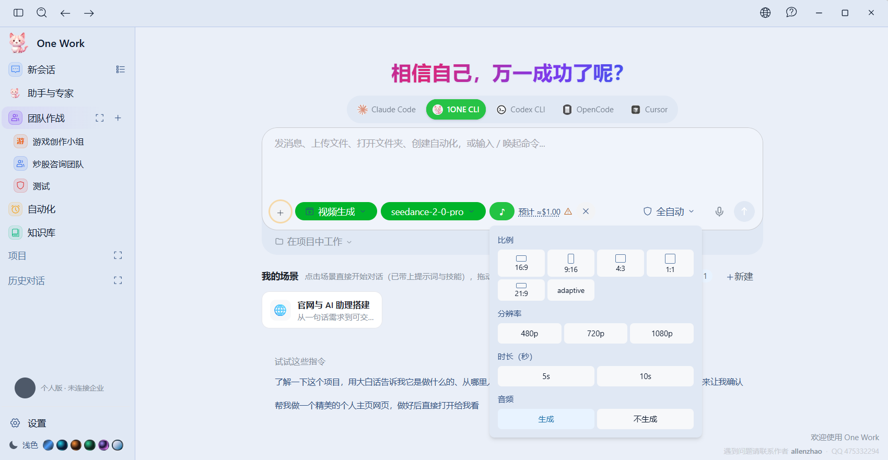
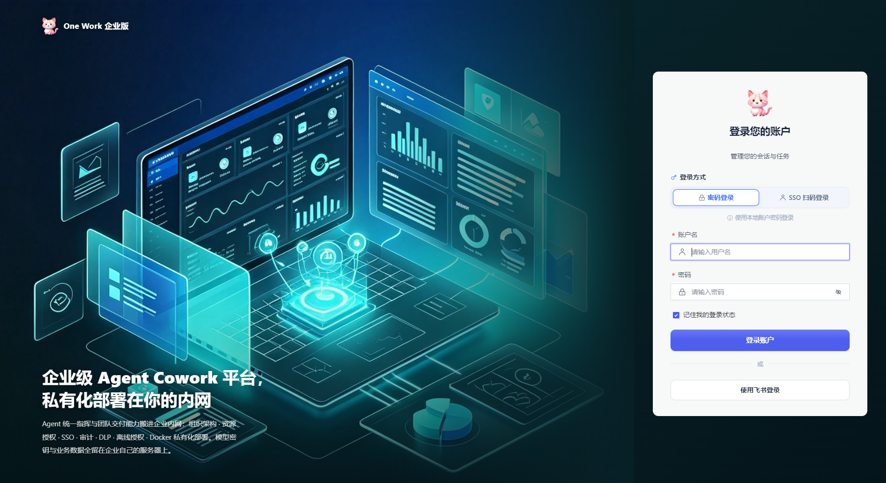
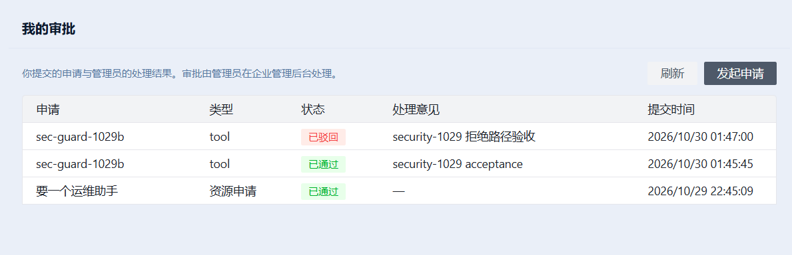
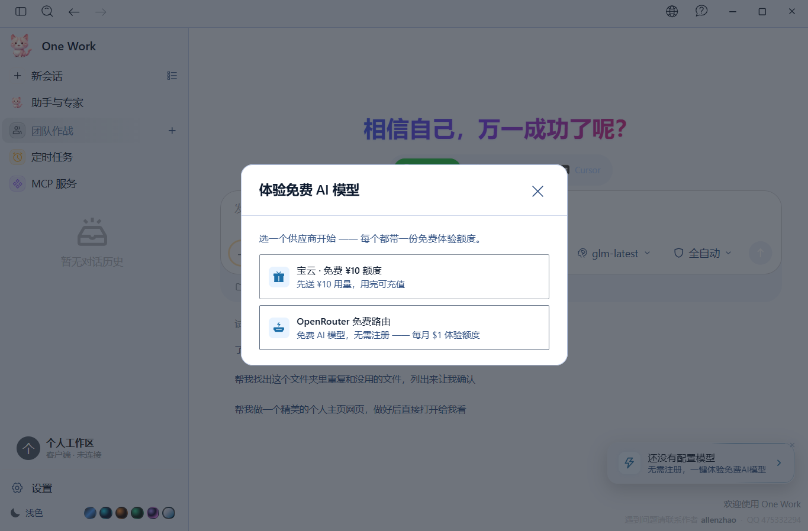
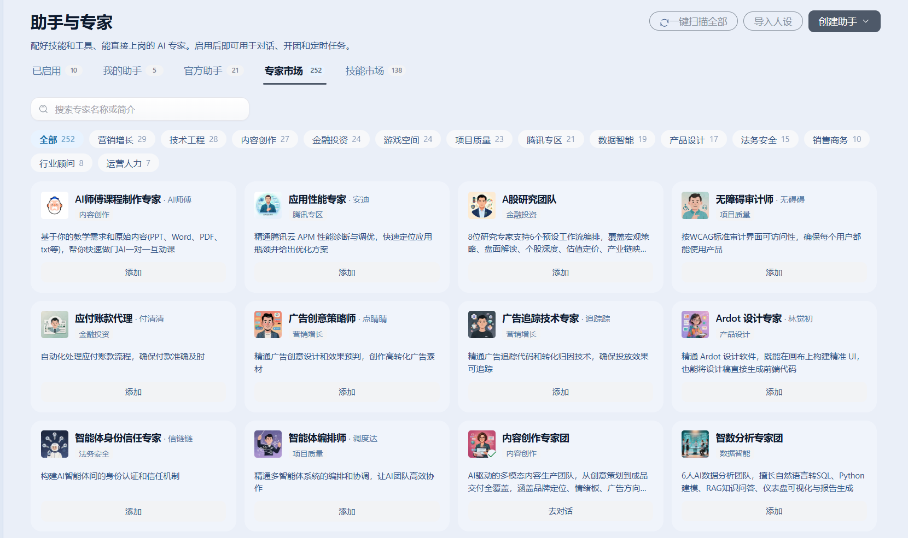
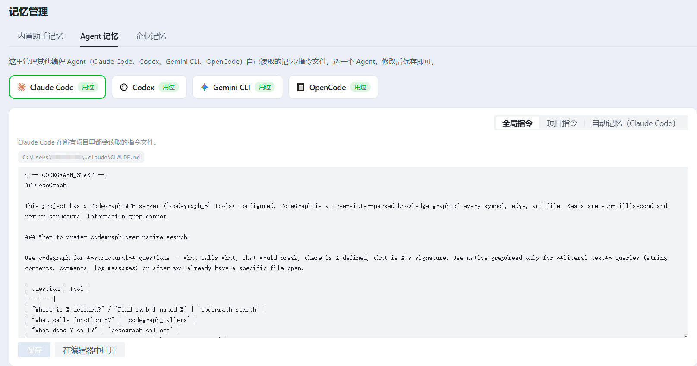

<div align="center">


# One Work

**又快 · 又安全 · 还省钱**

### Agent Cowork 平台 — 一个人用是创作引擎，一个团队用是交付平台

<br>


<br>



<br>

**少见地让 Codex CLI / Claude Code 官方客户端，直接换成你自己的模型。**

38 款 CLI Agent 统一指挥 · Team Mode 编队并行 · 场景一键下发 · 916+ 技能市场 · 记忆与知识库 · 定时自动化 · 对话与 Key 默认落本机

<br>

<a href="https://github.com/gaogg521/dream-ui/releases"></a>
&nbsp;
<a href="https://work.1oneclaw.com/"></a>
&nbsp;
<a href="https://work.1oneclaw.com/docs.html"></a>

<br><br>

| **38+** CLI Agent | **274** 助手与专家 | **916+** 技能市场 | **v3.0.14** 开箱即用 |
| :---------------: | :----------------: | :---------------: | :------------------: |
|   本机自动识别    | 22 官方 + 252 专家 |   可组合可下发    |   免费模型一键开聊   |


</div>

---

> **Cursor** 帮你写下一行代码 · **Copilot** 补全一个函数 · **One Work** 帮你**统管一整支 AI 队伍**，并把产出写进团队交付流程

---

## 核心优势

> 速度快 · 隐私安全 · 省钱 · **官方 CLI 一键桥接** · 本地化部署 —— 这五件事，决定了 One Work 不是「又一个聊天窗口」。

<br>

<table>
<tr>
<td width="120" align="center"><h2>01</h2><strong>速度快</strong><br><br><code>5×</code><br><sub>较某 Buddy</sub></td>
<td>

### 输出更快，交付不等

Team Mode 多 Agent **并行执行**：Leader 拆任务、Teammate 同时跑。同样交付约为某 Buddy 的 **5 倍**、某 Work 的 **3 倍**。

`Team Mode 并行` · `多成员同时执行` · `作战记录可导出`


</td>
</tr>
</table>

<br>

<table>
<tr>
<td width="120" align="center"><h2>02</h2><strong>隐私安全</strong></td>
<td>

### 数据与 Key 落本机

记忆、项目路径、API Key 与 `CLAUDE.md` **全部保存在本机目录**。远程 IM / WebUI 只是发指令，Agent 仍在你电脑上执行，**不经我们服务器中转**。

`记忆本地存储` · `Key 不外传` · `操作可批准可审计`


</td>
</tr>
</table>

<br>

<table>
<tr>
<td width="120" align="center"><h2>03</h2><strong>省钱</strong><br><br><code>−35%</code><br><sub>Token</sub></td>
<td>

### Token 消耗更低

**252 个编译期内置专家** + Skill 复用，减少重复 Prompt。同任务 Token 比某 Buddy 低约 **35%**、比某 Work 低约 **22%**。

`252 内置专家` · `Skill 复用` · `任意模型 API`


</td>
</tr>
</table>

<br>

<table>
<tr>
<td width="120" align="center"><h2>04</h2><strong>独家</strong><br><br>🔥<br><sub>桥接</sub></td>
<td>

### Codex / Claude 一键桥接 —— 我们最大的差异化

OpenAI **Codex CLI** 和 Anthropic **Claude Code** 被厂商锁死在官方账号。One Work 在本机起一个兼容端点，**官方 CLI 直接走你自配的 MiniMax、DeepSeek、Kimi 或自建网关** —— 纯本地转发，关闭即恢复。


</td>
</tr>
</table>

<br>

<table>
<tr>
<td width="120" align="center"><h2>05</h2><strong>本地化</strong></td>
<td>

### 企业内网 · 可私有化

WebUI 局域网 / 内网部署，配合 Issues 审计、数字员工与**离线授权** —— 数据不出边界。后端可 Docker 独立部署，桌面与 WebUI 以客户端模式连过去。

`WebUI 内网` · `Issues 审计` · `离线授权 ONEWORK-…`


</td>
</tr>
</table>

<br>

<table>
<tr>
<td width="120" align="center"><h2>06</h2><strong>企业版</strong></td>
<td>

### 企业管理后台 · 初始化向导 / 场景下发 / 资源审批

内网私有化后，用企业管理后台完成初始化六步：邀请成员（飞书 / 钉钉 / 企业微信 / OIDC / LDAP 单点登录）、激活 License、配置模型渠道、添加内容市场来源、设置安全策略档位。**场景**把技能、成员与资源授权打包成可一键下发的工作环境；成员申请资源、管理员审批，全程留痕。

`初始化向导 6/6` · `SSO / 飞书 / 钉钉 / LDAP` · `场景下发` · `资源申请审批` · `安全档位宽松/标准/严格`

<p align="center">
  
</p>
<p align="center">
  
</p>
<table>
<tr>
<td width="50%"><br><sub>后台场景管理 · 技能/成员/资源打包下发</sub></td>
<td width="50%"><br><sub>成员申请 · 管理员审批留痕</sub></td>
</tr>
</table>

</td>
</tr>
</table>

---

## v3.0 · 装好就能聊

首次启动 **一键启用内置免费模型**，无需先填 API Key。22 位官方助手 + 252 位行业专家编译期内置，断网也有完整目录。

<p align="center">
  
</p>

---

## 还能做什么

<details open>
<summary><strong>🧩 场景与数字员工 · 角色化开箱</strong></summary>
<br>
<table>
<tr>
<td width="50%"><br><sub>工作助手场景 · 带角色/技能/工具</sub></td>
<td width="50%"><br><sub>内置浏览器调研 → 产出清单卡片</sub></td>
</tr>
<tr>
<td width="50%"><br><sub>企业下发的场景 · 可随时开关</sub></td>
<td width="50%"><br><sub>数字员工 · 企业后台统一配置</sub></td>
</tr>
</table>
</details>

<details>
<summary><strong>🤝 Team Mode · 四步组队</strong></summary>
<br>
<table>
<tr>
<td width="25%"><br><sub>① 发起编队</sub></td>
<td width="25%"><br><sub>② 选成员</sub></td>
<td width="25%"><br><sub>③ 指定 Leader</sub></td>
<td width="25%"><br><sub>④ 并行交付</sub></td>
</tr>
</table>
作战记录可一键导出离线 HTML，工具调用全量保留。
</details>

<details>
<summary><strong>📋 Issues 看板 · 产出写进交付流程</strong></summary>
<br>
AI 一键拆单，任务直接交给 Agent，进度团队可见。
</details>

<details>
<summary><strong>🎨 AI 出图出片 · 花费实时可见</strong></summary>
<br>
<table>
<tr>
<td width="33%"><br><sub>文生图</sub></td>
<td width="33%"><br><sub>文生视频</sub></td>
<td width="33%"><br><sub>内容创作</sub></td>
</tr>
</table>
</details>

<details>
<summary><strong>📱 离开工位 · 不丢控制权</strong></summary>
<br>
<table>
<tr>
<td width="50%"><br><sub>WebUI 远程 · 手机扫码</sub></td>
<td width="50%"><br><sub>飞书 / 钉钉 / 微信 / Telegram</sub></td>
</tr>
</table>
</details>

<details>
<summary><strong>🎮 一句话做游戏 · 38 款 Agent 统一指挥</strong></summary>
<br>
<table>
<tr>
<td width="50%"><br><sub>38 款 CLI 自动识别</sub></td>
<td width="50%"><br><sub>一句话生成可玩 Demo</sub></td>
</tr>
</table>
</details>

<details>
<summary><strong>🧠 市场专家 · Skills 技能管理</strong></summary>
<br>
<table>
<tr>
<td width="50%"><br><sub>行业专家市场 · 开箱即用</sub></td>
<td width="50%"><br><sub>916+ 技能市场 · 可组合、可下发团队</sub></td>
</tr>
</table>
</details>

<details>
<summary><strong>🧠 记忆空间与资料库 · 越用越懂你</strong></summary>
<br>
<table>
<tr>
<td width="50%"><br><sub>记忆空间 · 与资料库放在一起查找</sub></td>
<td width="50%"><br><sub>共享记忆 / 项目记忆 / 企业记忆 · 旧记忆一键合并</sub></td>
</tr>
</table>

助手把「记住的事」存在本机记忆空间，开新对话自动读取；还能接管 Claude Code / Codex / Gemini CLI / OpenCode 各自的指令与记忆文件，统一编辑：

<table>
<tr>
<td width="50%"><br><sub>Agent 记忆 · 编程 Agent 的 CLAUDE.md 统一管理</sub></td>
<td width="50%"><br><sub>资料库 · 个人 / 团队 / 企业三级</sub></td>
</tr>
</table>
</details>

<details>
<summary><strong>⏰ 定时自动化 · 到点自己跑</strong></summary>
<br>
<p align="center"></p>
对话里一句话创建自动化，也可用内置模板（每日行业简报、每周学习复盘、天气与出行提醒…）；仅电脑唤醒时运行，可一键暂停。
</details>

<details>
<summary><strong>🗄️ 文件保险箱 · 敏感文件加密存放</strong></summary>
<br>
<p align="center"></p>
</details>

<details>
<summary><strong>🌐 9 种界面语言 · 全球团队开箱即用</strong></summary>
<br>
<p align="center"></p>
简体中文 / 繁體中文 / English / 日本語 / Français / Deutsch / Español / Português / Русский 一键切换。
</details>

---

## 和 Cursor / Copilot 比什么

|                               | **One Work** | Cursor | Copilot | Claude Code |
| ----------------------------- | :----------: | :----: | :-----: | :---------: |
| **Codex/Claude 桥接自配模型** | ✅ **独家**  |   ❌   |   ❌    |     ❌      |
| 38 款 Agent + Team 编队       |      ✅      |   ⚠️   |   ⚠️    |     ❌      |
| 274 助手与专家内置            |      ✅      |   ❌   |   ❌    |     ⚠️      |
| WebUI + IM 远程指挥           |      ✅      |   ❌   |   ❌    |     ❌      |
| 数据默认落本机                |      ✅      |   ⚠️   |   ⚠️    |     ⚠️      |
| 企业 Issues / 私有化          |      ✅      |   ❌   |   ❌    |     ⚠️      |

👉 [完整对比 · 阿里/腾讯/字节 Agent](https://work.1oneclaw.com/docs-faq.html)

---

## 3 分钟上手

1. [下载 v3.0](https://github.com/gaogg521/dream-ui/releases)（Windows `.exe` / macOS `.dmg` / Linux `.deb`）
2. 首次启动 → **一键启用免费模型** 或配置自己的 API Key
3. 选 **1ONE CLI** 或本机 Claude Code / Codex → 开聊
4. 需要桥接 → **设置 → Codex 桥接 / Claude 桥接**
5. 需要远程 → **设置 → WebUI** 或接入 IM 渠道

<details>
<summary>🍎 macOS Gatekeeper 被拦截？</summary>

```bash
xattr -cr "/Applications/One Work.app"
```

或 **系统设置 → 隐私与安全性 → 仍要打开**。

</details>

---

<details>
<summary><strong>🔧 开发者 · 本仓库 dream-ui</strong></summary>

<br>

One Work 桌面客户端 / WebUI 前端。后端：[dream-core](https://github.com/gaogg521/dream-core)（Rust `dreamcore`）。

```powershell
git clone https://github.com/gaogg521/dream-ui.git
git clone https://github.com/gaogg521/dream-core.git
cd dream-ui && bun install && bun run dev
```

| 文档                                                         | 说明            |
| ------------------------------------------------------------ | --------------- |
| [开发者上手指南](./docs/guides/fork-dev-onboarding.zh-CN.md) | 克隆、dev、打包 |
| [AGENTS.md](./AGENTS.md)                                     | 代码规范与测试  |

</details>

<details>
<summary><strong>❓ FAQ</strong></summary>

<br>

**252 位专家要联网吗？** 不要，编译期打进二进制，断网可用。

**桥接会被封号吗？** 本质是本地换掉模型来源，不破解官方鉴权，关开关即恢复。

**企业版要连你们服务器吗？** 不要，数据在局域网内，授权离线激活。

**为什么看不到 Cursor Agent？** 需安装 Cursor Agent CLI 并在设置里扫描。

</details>

---

<div align="center">

### 联系作者


<br>

[Issue](https://github.com/gaogg521/dream-ui/issues) · [Releases](https://github.com/gaogg521/dream-ui/releases) · [官网](https://work.1oneclaw.com/) · [dream-core](https://github.com/gaogg521/dream-core)

<br>

<sub>© 2026 One Work · 专有软件，保留所有权利</sub>

</div>
